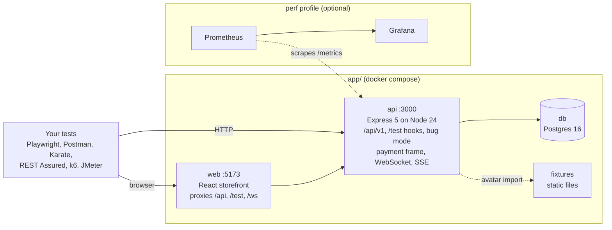

# PlayLab Platform

**A realistic e-commerce app with switchable defects, built to be tested.** Practise Playwright, API testing, contract and
security testing, performance testing and CI/CD against one local stack, then prove your tests work by turning on known bugs
and watching them go red.

[](https://github.com/crgtst/playlab-platform/actions/workflows/quality.yml)
[](https://github.com/crgtst/playlab-platform/actions/workflows/smoke.yml)
[](https://github.com/crgtst/playlab-platform/actions/workflows/playwright.yml)
[](https://github.com/crgtst/playlab-platform/actions/workflows/postman.yml)
[](https://github.com/crgtst/playlab-platform/actions/workflows/karate.yml)
[](https://github.com/crgtst/playlab-platform/actions/workflows/rest-assured.yml)
[](https://github.com/crgtst/playlab-platform/actions/workflows/contract.yml)
[](https://github.com/crgtst/playlab-platform/actions/workflows/security.yml)
[](https://github.com/crgtst/playlab-platform/actions/workflows/performance.yml)
[](https://github.com/crgtst/playlab-platform/actions/workflows/nightly.yml)
[](https://github.com/crgtst/playlab-platform/actions/workflows/codeql.yml)
[](LICENSE)

**Latest reports:** [traceability and defect matrix](https://crgtst.github.io/playlab-platform/) ·
[security report](docs/security-report.md) · [pipelines](docs/CI.md)

> [!WARNING]
> **Local use only.** PlayLab is deliberately defective and ships with test hooks that create admin users and wipe the
> database. Never deploy it to a server, expose it to the internet or put real data in it. See [SECURITY.md](SECURITY.md).

## Why it exists

Most practice sites let you write tests but can't tell you whether those tests would catch anything. PlayLab can.

- **Bug mode.** 47 named defects across the API, web app, payment frame and service worker. Switch any of them on with
  one HTTP call; each changes only its own behaviour and maps to the acceptance criterion it breaks. A nightly run switches on
  random ones and fails if no test notices.
- **A real specification.** 29 Jira-ready stories with 172 numbered acceptance criteria
  ([`docs/ACCEPTANCE_CRITERIA.md`](docs/ACCEPTANCE_CRITERIA.md)), so every test traces back to a requirement. The
  [traceability report](docs/traceability.md) shows which tool covers which criterion.
- **Test hooks a real team would want.** A reset in about 50 ms, isolated test sessions, named fixtures, throwaway and bulk
  users, a seeded data generator, a movable server clock, injected latency and failures, and a test mailbox.
- **The awkward parts of the web, on purpose.** A cross-origin payment iframe, WebSocket and Server-Sent Events, shadow
  DOM, a service worker, geolocation, clipboard, drag and drop, native dialogs, new tabs and a Chrome extension.
- **Money rules worth testing.** Integer cents, VAT on the discounted value, capped discount codes, idempotent order
  submission, an order lifecycle and row locking on stock.

## See a defect get caught

```bash
cd tests/playwright-ts && npm ci

# With the stack running and every defect off: green
npx playwright test -g "PLS-5.2"

# Force a defect on for the run (each test has its own session, so this switches it on in all of them): the test goes red
DEFECTS=expired-discount-accepted npx playwright test -g "PLS-5.2"
```

To explore a defect by hand instead, switch it on for the whole stack, try the shop or the API, then switch it off:

```bash
curl -X POST localhost:3000/test/bugs -H 'Content-Type: application/json' -d '{"enable":["expired-discount-accepted"]}'
curl -X DELETE localhost:3000/test/bugs   # all defects off
```

Use your `API_PORT` in place of `3000` if you changed it. The idea is automated too: `tests/security` runs each security defect and
requires its test to fail, and the nightly pipeline does the same for random defects from all 47.

## Quickstart

You need [Docker](https://docs.docker.com/get-docker/) with Compose v2. Nothing else is needed to run the shop.

```bash
git clone https://github.com/crgtst/playlab-platform.git
cd playlab-platform/app
docker compose up --build -d      # builds the images (a few minutes the first time)
```

Or skip the build and pull the published images (Intel/AMD and Apple silicon):

```bash
docker compose -f docker-compose.yml -f docker-compose.images.yml up -d
```

The stack is ready when `http://localhost:3000/api/v1/health` returns `200` with every check `up`. If port 3000, 5173 or 5432
is taken, set `API_PORT`, `WEB_PORT` or `DB_PORT`, for example `API_PORT=3001 docker compose up --build -d`.

1. Open the shop at <http://localhost:5173> and log in as `customer@playlab.test` with password `Password123!`.
2. Add a product to the cart and pay with card `4242 4242 4242 4242`, any future expiry and any CVC.
3. Browse the API at <http://localhost:3000/api/docs>.
4. Stop and wipe all data with `docker compose down -v`.

> [!NOTE]
> Developed and run on macOS with Apple silicon. Windows (with Docker Desktop and WSL 2) and Linux should work, because
> everything runs in containers, but the author has not run them yet. If something differs, please
> [open an issue](https://github.com/crgtst/playlab-platform/issues/new/choose). On Windows, clone inside the WSL file system.

Accounts, test cards, hooks, URLs and locator conventions are documented in the app reference,
[`app/README.md`](app/README.md).

## What you can practise

| Skill | What the platform gives you | Suite | Practice |
| --- | --- | --- | --- |
| Playwright (UI) | `data-testid` on every control, every awkward browser pattern above, clock control, test sessions for parallel runs | [`tests/playwright-ts`](tests/playwright-ts/) | [exercises](docs/exercises/playwright.md) |
| API testing | 78 operations in OpenAPI, one error shape, `Idempotency-Key`, ETag and `If-Match`, an order lifecycle | [`tests/postman`](tests/postman/), [`karate`](tests/karate/), [`rest-assured`](tests/rest-assured/) | [exercises](docs/exercises/api-testing.md) |
| Contract testing | A design-first OpenAPI file, a breaking-change gate, fuzzing, consumer contracts and provider states | [`tests/contract`](tests/contract/), `app/web/pact` | [exercises](docs/exercises/contract.md) |
| API security | The OWASP API Top 10 as 15 planted defects, each with a secure test and an exploit; ZAP scans | [`tests/security`](tests/security/) | [exercises](docs/exercises/security.md) |
| Performance | A production-mode profile with Prometheus and Grafana, generated data, one load model for two tools | [`tests/k6`](tests/k6/), [`tests/jmeter`](tests/jmeter/) | [exercises](docs/exercises/performance.md) |
| CI/CD | 17 required checks, a nightly defect sweep, a published report site, CodeQL, Trivy and a secret scan | [`.github/workflows`](.github/workflows/) | [exercises](docs/exercises/cicd.md) |

Each exercise has a beginner, intermediate and advanced level. The [answer key](docs/answers/) (with spoilers) says where each
one is solved in this repository.

## How it fits together



The browser talks to one origin: the web app proxies `/api`, `/test` and `/ws` to the API, so cookies are first-party.
The payment iframe is served by the API on its own origin, so checkout is genuinely cross-origin, as with a real payment
provider.

## Repository layout

```
playlab-platform/
├── app/                # web (React + Vite), api (Express + TypeScript), docker-compose files, perf stack, fixtures
├── tests/              # one folder per suite; shared/ holds the data contract, schemas and load model
├── docs/               # SPEC, ACCEPTANCE_CRITERIA, traceability, exercises/, answers/, CI.md, REVIEW_AND_PLAN.md
├── tools/              # traceability, nightly sweep, report site, contract and calibration scripts
└── .github/            # workflows, the reusable start-stack action, the merge rule
```

## Roadmap

The full plan is in [`docs/REVIEW_AND_PLAN.md`](docs/REVIEW_AND_PLAN.md); progress is in [`PROJECT_STATUS.md`](PROJECT_STATUS.md)
and releases in the [changelog](CHANGELOG.md).

| Phase | Focus | Status |
| --- | --- | --- |
| 0 | Foundations: Node 24, lint and format, CI, README, AC reconciliation | Done |
| 1 | Platform core: test sessions, correlation IDs, metrics, order lifecycle, `If-Match`, account endpoints | Done |
| 2 | Functional suites: Playwright (TypeScript), Postman/Newman, Karate, REST Assured | Done |
| 3 | Contract, security and performance suites, CI/CD; **v1.0.0** | Done |
| 4 | Playwright in Java, then Python | Planned |
| 5 | Stretch: PlayLab Pay, a separate payment service | Planned |

## Working on the platform

The app runs in Docker. To change platform code you also need Node 24. See [CONTRIBUTING.md](CONTRIBUTING.md) for the rules.

```bash
npm install                      # once, at the repo root: lint and format tools and the pre-commit hook
npm run lint                     # ESLint
npm run format:check             # Prettier
cd app/api && npm ci && npm test # API unit tests (no database needed)
cd app/api && npm run test:int   # API integration tests (needs the db container)
cd app/e2e && npm ci && npm test # platform smoke tests in a browser (needs the stack running)
```

## Licence

[MIT](LICENSE).
