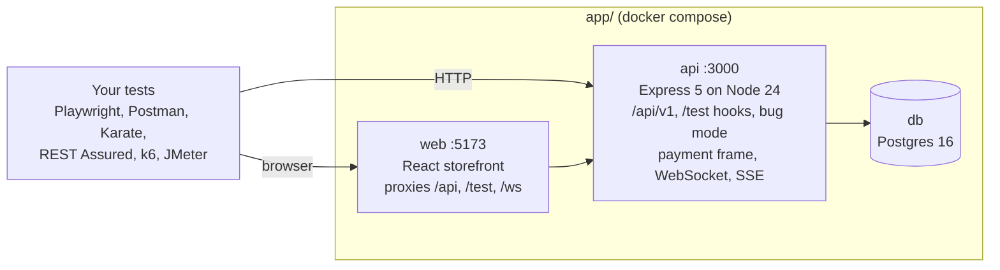

# PlayLab Platform

**A realistic e-commerce app with switchable defects, built to be tested.** Practise Playwright, API testing, contract
and security testing, performance testing and CI/CD against one local stack, and prove your tests work by turning on
known bugs and watching them go red.

[](https://github.com/crgtst/playlab-platform/actions/workflows/quality.yml)
[](LICENSE)

> [!WARNING]
> **Local use only.** PlayLab is deliberately defective and ships with test hooks that create admin users and wipe the
> database. Never deploy it to a server, expose it to the internet or put real data in it. See [SECURITY.md](SECURITY.md).

<!-- TODO (Gate 3): GIF of a defect being switched on and a test going red. -->

## Why it exists

Most practice sites let you write tests but can't tell you whether those tests would catch anything. PlayLab can.

- **Bug mode.** 33 named defects across the API, web app, payment frame and service worker. Switch any of them on with
  one HTTP call; each changes only its own behaviour and maps to the acceptance criterion it breaks.
- **A real specification.** 29 Jira-ready stories with 153 numbered acceptance criteria
  ([`tests/ACCEPTANCE_CRITERIA.md`](tests/ACCEPTANCE_CRITERIA.md)), so every test can trace back to a requirement.
  97 describe the app as built; the rest specify the platform features on the roadmap.
- **Test hooks a real team would want.** A reset in about 50 ms, named fixtures, a throwaway-user factory, a movable
  server clock, injected latency, and deterministic or random failures.
- **The awkward parts of the web, on purpose.** A cross-origin payment iframe, WebSocket and Server-Sent Events, shadow
  DOM, a service worker, geolocation, clipboard, drag and drop, native dialogs, new tabs and a Chrome extension.
- **Money rules worth testing.** Integer cents, VAT on the discounted value, capped discount codes, idempotent order
  submission and row locking on stock.

## Quickstart

You need [Docker](https://docs.docker.com/get-docker/) with Compose v2.

```bash
git clone https://github.com/crgtst/playlab-platform.git
cd playlab-platform/app
docker compose up --build -d
```

The first build takes a few minutes. The stack is ready when
[`/api/v1/health`](http://localhost:3000/api/v1/health) returns `200` with every check `up`. If port 3000 or 5173 is
taken, set `API_PORT` or `WEB_PORT`, for example `API_PORT=3001 docker compose up --build -d`.

1. Open the shop at <http://localhost:5173> and log in as `customer@playlab.test` with password `Password123!`.
2. Add a product to the cart and pay with card `4242 4242 4242 4242`, any future expiry and any CVC.
3. Switch a defect on and repeat a request to see it misbehave:

   ```bash
   curl -X POST localhost:3000/test/bugs -H 'Content-Type: application/json' -d '{"enable":["wrong-status-code"]}'
   curl -X POST localhost:3000/api/v1/auth/login -H 'Content-Type: application/json' -d '{}'   # 500, not 422
   curl -X DELETE localhost:3000/test/bugs                                                     # all defects off
   ```

4. Stop and wipe all data with `docker compose down -v`.

Accounts, test cards, hooks, URLs and locator conventions are documented in the app reference,
[`app/README.md`](app/README.md). The API is described in OpenAPI 3 and browsable at <http://localhost:3000/api/docs>.

## What you can practise

| Skill | What the platform gives you | Suite |
| --- | --- | --- |
| Playwright (UI) | `data-testid` on every control, every awkward browser pattern above, clock control, a component-test harness | Planned |
| API testing | 50 OpenAPI paths, one error shape, `Idempotency-Key`, ETag/304, and a wide range of 4xx statuses | Planned |
| Postman / Newman | OpenAPI that imports straight into Postman; reset, seed and users as plain HTTP hooks | Planned |
| Karate | Same API and hooks | Planned |
| REST Assured | Same API and hooks | Planned |
| Contract testing | A design-first OpenAPI 3 file served at `/api/openapi.json` | Planned |
| API security | Planted authorisation, token and input-handling defects to find and prove | Planned |
| Performance (k6, JMeter) | Latency injection, a realistic bcrypt login and row locking on orders; a perf profile is planned | Planned |
| CI/CD | A quality workflow (lint, format, typecheck, app unit tests) on every pull request | In progress |

The test suites are being written now, one folder per tool under `tests/`. Progress is tracked in
[`PROJECT_STATUS.md`](PROJECT_STATUS.md).

## How it fits together



The browser talks to one origin: the web app proxies `/api`, `/test` and `/ws` to the API, so cookies are first-party.
The payment iframe is served by the API on its own origin, so checkout is genuinely cross-origin, as with a real payment
provider.

## Repository layout

```
playlab-platform/
├── app/                # web (React + Vite), api (Express + TypeScript), docker-compose.yml, price-tracker extension
├── tests/              # SPEC.md, ACCEPTANCE_CRITERIA.md; one folder per test suite as they are added
├── docs/               # REVIEW_AND_PLAN.md: the roadmap
└── .github/            # workflows and Dependabot
```

## Roadmap

The full plan is in [`docs/REVIEW_AND_PLAN.md`](docs/REVIEW_AND_PLAN.md).

| Phase | Focus | Status |
| --- | --- | --- |
| 0 | Foundations: Node 24, lint and format, CI, this README, AC reconciliation | In progress |
| 1 | Platform core: test sessions, correlation IDs, metrics, order lifecycle, `If-Match`, account endpoints | Planned |
| 2 | Functional suites: Playwright (TypeScript), Postman/Newman, Karate, REST Assured | Planned |
| 3 | Contract, security and performance suites; release v1.0.0 | Planned |
| 4 | Playwright in Java, then Python | Planned |
| 5 | Stretch: PlayLab Pay, a separate payment service | Planned |

## Working on the platform

The app runs in Docker. To change platform code you also need Node 24.

```bash
npm install                      # once, at the repo root: lint and format tools and the pre-commit hook
npm run lint                     # ESLint
npm run format:check             # Prettier
cd app/api && npm ci && npm test # API unit tests (no database needed)
cd app/api && npm run test:int   # API integration tests (needs the db container)
cd app/e2e && npm ci && npm test # platform smoke tests in a browser (needs the stack running)
```

## Licence

[MIT](LICENSE).
