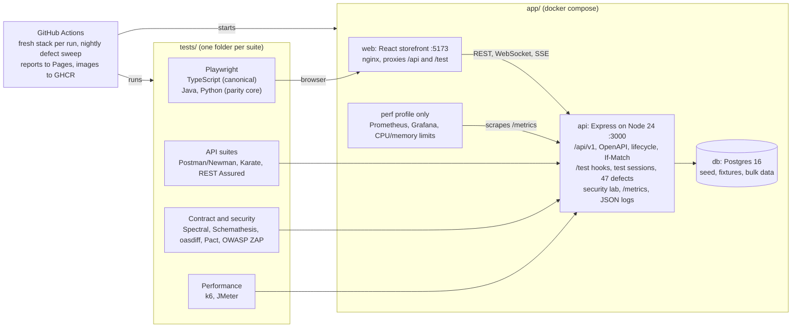
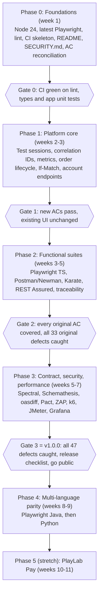
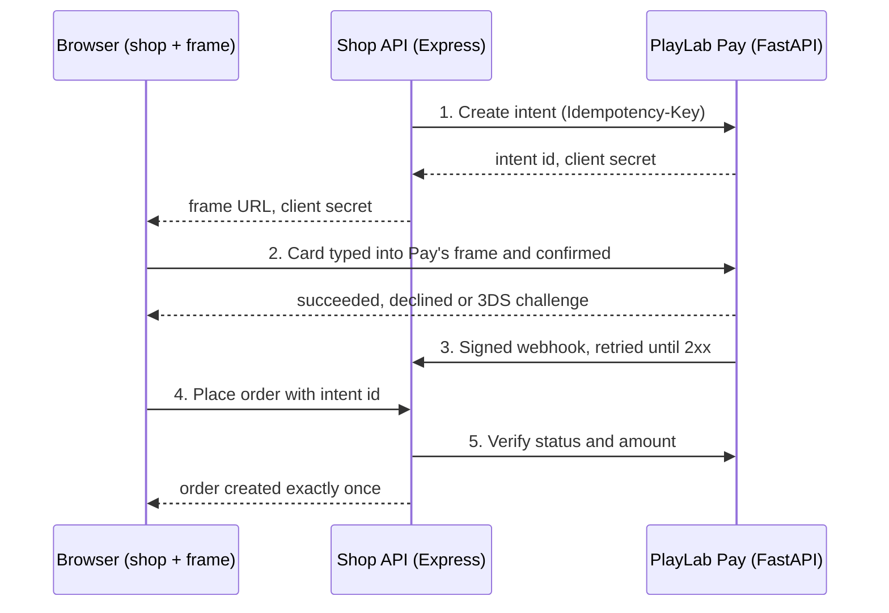

# PlayLab Platform — Full Review and Upgrade Plan

21 Oct 2026 · Craig

## Verdict

**PlayLab Shop can be the whole training platform, but it needs about 6 to 8 weeks of targeted rework to be top class.** Extend it; don't replace it. The app is already a stronger Playwright target than most public practice sites. The gaps are mostly around it rather than in it.

- **What's missing:** every test suite, CI, the repo's public face, and the platform features that performance, contract and security testing need.
- **What should change in the app:** test-state isolation for parallel runs, order-lifecycle rules, optimistic locking, observability, and a performance profile.
- **The FastAPI rebuild in the v2.0 spec is cancelled.** Its useful ideas (correlation IDs, `If-Match`, per-request faults, the performance lab) move into this plan as additions to the Express API.

The review covered the app code (API routes, middleware, test hooks, bug mode), the Docker setup, `tests/SPEC.md`, `tests/ACCEPTANCE_CRITERIA.md` (19 stories) and the 1,944-line OpenAPI file, at commit `a706efa` on 21 Oct 2026.

## Scorecard

The app strongly supports 2 of the 11 skill areas today and partly supports 5. No test assets exist in the repo for any of them: `tests/` holds only the spec and ACs, plus a component-test harness in `app/web`.

| Skill area | Platform support today | What's there | Main gaps | Effort to close |
| --- | --- | --- | --- | --- |
| Playwright (UI) | Strong | Every major Playwright capability has a feature to test, `data-testid` everywhere, reset and fixtures, clock control, 33 defects | No suite yet. Test state is global, so parallel workers can't isolate bugs, chaos or clock. Some Phase 4 ACs aren't built | Platform 3 days; suite ongoing |
| API testing (general) | Strong | 50 OpenAPI paths, one error shape, idempotency, ETag/304, 401/403/404/409/413/415/422/423/429 | Order status accepts any transition. No optimistic locking. No profile, account-deletion or admin-user endpoints. No correlation IDs | 4 days |
| Contract testing | Partial | OpenAPI 3 file served at `/api/openapi.json` with Swagger UI | No spec linting, no response-conformance check, no breaking-change gate, no consumer contracts | 3 days |
| API security testing | Partial | BOLA (`order-leak`), token expiry, price tamper, magic-byte upload check, stored-XSS review, lockout | No security headers outside the payment frame. No OWASP API Top 10 map. No mass-assignment, BFLA, enumeration or JWT-algorithm labs. No ZAP scan | 4 days |
| Postman / Newman | Partial | OpenAPI imports straight into Postman; hooks are plain HTTP | No collection, environments or Newman reports | Suite only |
| Karate | Partial | Same as Postman | No suite or schemas exported for `match` | Suite only |
| REST Assured | Partial | Same as Postman | No Java project; no JSON Schemas extracted from OpenAPI | Suite only |
| Performance testing | Weak | Latency hook, realistic bcrypt login, row locking on orders | Rate limit (100/min) throttles any load test. 40 products and 3 users is too little data. No metrics, no resource limits, no SLOs | 4 days |
| JMeter | Weak | Depends on performance platform work | No test plans | Suite only |
| k6 | Weak | Depends on performance platform work | No scripts | Suite only |
| CI/CD pipelines | None | Compose healthchecks ready for CI | No workflows, no lint, no app unit tests, `npm install` not `npm ci`, no image scanning, Node 20 is past end of life | 3 days |

Effort is rough, in days of build work with Claude Code doing most of the platform changes. Writing the suites is your training, so it isn't estimated.

## What PlayLab Shop already does well

These are worth protecting through the rework, and worth putting first in the public README.

- **Test hooks a real team would envy.** It has a 50 ms reset, 12 named fixtures and a throwaway-user factory. A movable server clock drives token expiry, lockouts, discount windows and order dates. Deterministic `failNext` chaos complements random failure rates.
- **Bug mode is the standout feature.** It has 33 named defects across API, web, payment frame and service worker. Each one maps to the AC it breaks and changes only its own behaviour. Very few public practice apps offer this.
- **Realistic, specified money rules.** Integer cents, VAT on the discounted value, capped fixed codes, and price-change detection at order time.
- **Hard concurrency cases handled properly.** `Idempotency-Key` replay with `Idempotent-Replayed`, serialised concurrent submits, `SELECT ... FOR UPDATE` on stock and discount codes.
- **Every awkward browser pattern exists.** Cross-origin payment iframe, WebSocket and SSE, shadow DOM, service worker, popups, new tabs, native dialogs, `beforeunload`, drag and drop, geolocation, clipboard, Battery API, a Chrome extension, and 3 planted axe faults.
- **Sound security basics.** HS256 pinned on verify, httpOnly cookies, hashed single-use refresh tokens, magic-byte upload detection, `frame-ancestors` CSP on the payment frame, and test hooks that disappear (404) when `TEST_HOOKS=false`.
- **Documentation that is already near publishable.** The app README is detailed and accurate: test IDs, Playwright notes, money rules and a defect table.

## Findings: API and app

There are 11 findings: 4 high, 5 medium and 2 low. The high ones block parallel testing, performance testing or a clean domain model, so they come first in the roadmap.

| ID | Severity | Finding | Evidence | Fix |
| --- | --- | --- | --- | --- |
| A1 | High | **Test state is global to the process.** Bugs, chaos, latency, the clock and rate-limit counters are module-level variables. One Playwright worker switching on `order-leak` or moving the clock changes every other worker's run | `lib/bugs.ts` (`enabled` Set), `middleware/testFaults.ts` (rule arrays), `lib/clock.ts` (`offsetMs`) | Test sessions: state keyed by an `X-Test-Session` header or cookie, with global as the fallback (spec in API additions) |
| A2 | High | **Order status accepts any transition.** An admin can move `delivered` back to `pending`, or `cancelled` to `shipped`, singly or in bulk | `routes/orders.ts`: `PATCH /:id/status` and `POST /bulk-status` update without checking the current status | Transition map, 409 `INVALID_TRANSITION`, new ACs and a defect that turns the check off |
| A3 | High | **No observability.** There are no request logs or correlation IDs, and unhandled errors only go to `console.error` | `app.ts` has no logging middleware; `errorHandler.ts` | Structured JSON logs (pino), `X-Correlation-Id` in and out, `/metrics` for Prometheus |
| A4 | High | **The stack can't be load-tested meaningfully.** 100 requests a minute per user or IP stops any load test within seconds. There are 40 products and 3 users, no container resource limits and no metrics | `middleware/rateLimit.ts`, `db/seed/base.ts`, `docker-compose.yml` | A `perf` Compose profile, bulk data generation, CPU/memory limits, metrics and SLOs |
| A5 | Medium | **Writes are last-write-wins.** Product `GET` sends an `ETag`, but `PUT` and `PATCH` ignore `If-Match`, so two admins silently overwrite each other | `routes/products.ts` (`updateProduct`) | `If-Match` on product and order-status writes: 412 if stale, 428 if missing |
| A6 | Medium | **Account and user-admin endpoints are missing.** There's no profile update, no account deletion and no admin user management. The SPEC scenario "Account deletion removes the user's data" can't be tested | `routes/users.ts` has only avatar routes | `PATCH /users/me`, `DELETE /users/me`, `GET/PATCH /admin/users` (also needed for the mass-assignment and BFLA labs) |
| A7 | Medium | **The rate limit can probably be bypassed with `X-Forwarded-For`.** `trust proxy` includes `uniquelocal`, and host traffic to port 3000 arrives from the Docker bridge (a private range). A guest can then likely rotate the header to get a fresh limit | `app.ts`: `app.set('trust proxy', 'loopback, linklocal, uniquelocal')` | Verify with a test. Trust only the web proxy's address by default, and keep the bypass as an opt-in defect (`rate-limit-bypass`): it's a great security exercise |
| A8 | Medium | **Security headers are missing everywhere except the payment frame**: no `X-Content-Type-Options`, `Referrer-Policy`, CSP or `Permissions-Policy` | Only `routes/payments.ts` sets a header | Add helmet-style headers, plus a `missing-security-headers` defect for scanner practice |
| A9 | Medium | **ACs and the build have drifted.** `bugs.ts` says Phase 4 has "no AC IDs yet", but PLS-13 to 19 exist. PLS-18.2 (tap opens full screen) contradicts the README (tap advances). PLS-15.3 (Ctrl+C fallback), PLS-13.2's exact message and PLS-17.2 (checkout disabled offline) don't appear in the web code | `lib/bugs.ts` comments; `README.md` gallery notes; `web/src` search | An AC reconciliation pass: fix the code or the AC, then update the defect map |
| A10 | Low | **Runtime and tooling are out of date.** Node 20 reached end of life on 30 April 2026. Playwright CT is 1.49.1, against 1.64.1 current | `Dockerfile`s (`node:20-alpine`), `web/package.json` | Node 24 LTS, latest Playwright, a Dependabot config |
| A11 | Low | **No tests of the app itself.** A defect that breaks the app (not a bug-mode one) can ship unnoticed. For a public project, that undermines the "each defect changes only its behaviour" promise | No unit or integration tests in `app/` | Vitest plus supertest for the API, focused on pricing, bug isolation and hooks |

## Findings: repo, CI and portfolio quality

The repo's public face is the weakest part of the project. The root README is 14 bytes and there is no pipeline, so a visitor can't see what you've built.

| ID | Severity | Finding | Fix |
| --- | --- | --- | --- |
| R1 | High | Root `README.md` is just `# playlab-shop`. A visitor sees nothing of the platform | A landing README: what it is, a diagram, a "what you can practise" table, a 2-minute quickstart, badges and links to reports |
| R2 | High | No CI at all: no `.github/workflows` | Pipelines in the CI/CD plan below |
| R3 | High | No `SECURITY.md` or deployment warning. A deliberately vulnerable app shared publicly must say clearly that it is for local use only | `SECURITY.md`; a banner in the README; `TEST_HOOKS` and defects refuse to start when `NODE_ENV=production` unless explicitly overridden |
| R4 | Medium | The defect list in the README is also the answer key, so a learner sees every bug before hunting | Move answers to `docs/answers/` behind a spoiler notice; the README lists exercises instead |
| R5 | Medium | No lint, format or type gate: no ESLint, Prettier, EditorConfig or pre-commit hooks | ESLint, Prettier, `lint-staged` and a CI quality job |
| R6 | Medium | Images aren't reproducible or hardened: `npm install` not `npm ci`, root user, the web image ships dev dependencies | `npm ci`, non-root `USER`, multi-stage web image served by nginx, Trivy scan in CI |
| R7 | Medium | No community or release files: CONTRIBUTING, issue templates, CHANGELOG, tags | Add them, and cut `v1.0.0` when the plan's Phase 3 gate passes |
| R8 | Low | `.DS_Store` is committed | Delete it and add it to `.gitignore` |

Publishing test reports matters for a portfolio. GitHub Pages can host the latest Playwright, Newman, Karate, k6 and ZAP reports from `main`, so a reviewer sees real results without cloning anything.

## Multi-language Playwright

The app needs almost nothing to support other languages: its hooks are plain HTTP, its locators are `data-testid` and roles, and its API has an OpenAPI file. The work is making the suites equivalent and comparable.

Playwright has four official bindings: Node (TypeScript or JavaScript), Python, Java and .NET. JavaScript isn't a separate binding: TypeScript compiles to it and uses the same runner. So JavaScript is a style choice inside the Node suite rather than a separate suite.

| Suite | Runner | Scope | What's different in this language |
| --- | --- | --- | --- |
| `playwright-ts` (canonical) | Playwright Test | Every AC, every browser project, sharding | Component tests, `toHaveScreenshot` visual comparison, UI mode and test agents are Node-only. They live here alone |
| `playwright-python` | pytest + pytest-playwright | Parity core (about 35 ACs, below) | Parallelism via pytest-xdist; no built-in screenshot comparison; axe via a community package |
| `playwright-java` | JUnit 5 (`@UsePlaywright`) + Maven | Parity core | Shares the Maven build with REST Assured and Karate, which keeps Java tooling in one place |
| `playwright-dotnet` (later) | NUnit | Parity core | Optional; worth it if you target .NET employers |

**Parity rules every suite follows**

1. Test names start with the AC ID (`PLS-5.2 expired code is rejected`), so one report can merge all languages.
2. One shared data contract in `tests/shared/`: accounts, product IDs, test cards and fixture names as JSON. No suite hard-codes them.
3. The same page-object names and methods in every language (`CartPage.applyCode`), so suites can be compared side by side.
4. Every suite writes JUnit XML, the input to the traceability report.
5. A parity table in the README shows which ACs each language covers, generated from those reports.

**Parity core (about 35 ACs).** Login and lockout (PLS-1), registration via the mailbox (PLS-2), search, filter and pagination (PLS-3), cart and stock (PLS-4), one discount path (PLS-5.1, 5.2), checkout with the payment iframe including decline (PLS-6.1 to 6.3), order access (PLS-7.2), admin status change with WebSocket update (PLS-8.2), and one bug-mode run proving a defect is caught.

Python and Java can test the newer browser features too: clock control, WebSocket routing and aria snapshots are all available outside Node. Keep them out of the parity core, though, until the core is green in every language.

## Skill-by-skill plan

Each skill gets a suite in its own folder, its own report and one showcase exercise that proves real skill rather than tool familiarity.

| Skill | Platform work needed | Suite and techniques | Showcase exercise |
| --- | --- | --- | --- |
| **Playwright** | Test sessions (A1), AC reconciliation (A9) | Page objects, role fixtures, `storageState` setup project, 4 browser projects, sharding, tags, custom matcher, AC traceability reporter, visual and axe checks | The **defect matrix**: CI switches on each of the 33+ defects in turn and shows which tests went red |
| **API testing** | Lifecycle rules (A2), `If-Match` (A5), account endpoints (A6), correlation IDs (A3) | Playwright `request` tests for setup and checks, alongside the tool suites below | An error-code matrix: every endpoint × every status it can return, generated from OpenAPI and asserted |
| **Postman / Newman** | None | Collection by domain, environments (`local`, `ci`, `perf`), pre-request token script, schema checks with `ajv`, data-driven runs from CSV | Newman in CI with an htmlextra report, plus a data-driven registration run covering 50 boundary inputs |
| **Karate** | Export component schemas to `tests/shared/schemas/` | Features per domain, `karate-config.js` environments, `callonce` reset, fuzzy `match` against schemas, parallel runner | A Karate mock server standing in for the payment provider, plus one Gatling-backed load scenario reusing the same features |
| **REST Assured** | Same schemas | Maven + JUnit 5, `RequestSpecBuilder`, POJOs generated from OpenAPI, JSON Schema validator, Allure | A concurrency test: 20 threads buy the last item; exactly one succeeds, and the `stock-oversell` defect makes it fail |
| **Contract testing** | A contract-test job in CI; Pact provider states in the test hooks | Spectral lint of the OpenAPI file, Schemathesis fuzzing against the running API, `oasdiff` breaking-change gate on pull requests, Pact consumer tests in the web app with provider verification in the API | A pull request that renames a response field fails the `oasdiff` and Pact gates, shown in the README |
| **API security testing** | Security lab defects, headers (A8), rate-limit fix (A7), account endpoints (A6) | OWASP API Security Top 10 (2023) test cases, JWT tampering (`alg: none`, wrong key, expired), ZAP baseline and API scans from the OpenAPI file | One test per OWASP API risk, each with a defect that makes it fail, written up as a security test report |
| **Performance testing** | `perf` profile, bulk data, metrics, limits, SLOs (A4) | Smoke, load, stress, spike and soak scenarios with thresholds tied to SLOs | The same load model in k6 and JMeter, with results compared on one Grafana dashboard |
| **JMeter** | Perf profile | `.jmx` plans in git, non-GUI CLI runs, CSV data from bulk users, correlation (token extraction), HTML dashboard | A checkout journey under load, showing throughput falling once the row locks on stock start contending |
| **k6** | Perf profile | Scenario executors, checks, thresholds, `handleSummary` to JUnit and HTML, Prometheus remote write | A threshold failing the build when `p(95)` latency on `GET /products` goes over the SLO with injected latency |
| **CI/CD pipelines** | Workflows (R2), hardened images (R6) | GitHub Actions: quality, functional, API, contract, security and performance jobs; reusable "start the stack" action; reports to GitHub Pages; images to GHCR on release | A PR status page showing every gate, and a nightly run that switches on random defects and checks they're caught |

## Target architecture

The repo stays one monorepo with the app in `app/` and one folder per suite in `tests/`. A single pipeline starts a fresh stack and runs every suite against it.



Playwright reaches the API through the storefront. Every other suite calls the API directly. The perf profile adds Prometheus and Grafana only when you load-test, so the everyday stack stays light.

```
playlab-platform/
├── README.md                  # landing page: what, why, quickstart, reports
├── SECURITY.md  CONTRIBUTING.md  CHANGELOG.md  LICENSE
├── app/                       # web, api, docker-compose.yml (+ perf profile)
├── tests/
│   ├── shared/                # accounts.json, products.json, cards.json, schemas/
│   ├── playwright-ts/
│   ├── playwright-java/       # Maven, shares parent POM with rest-assured, karate
│   ├── playwright-python/
│   ├── postman/               # collection, environments, data files
│   ├── karate/
│   ├── rest-assured/
│   ├── contract/              # spectral.yaml, schemathesis, oasdiff, pact
│   ├── security/              # zap rules, OWASP test cases
│   ├── k6/
│   └── jmeter/
├── docs/
│   ├── SPEC.md  ACCEPTANCE_CRITERIA.md  traceability.md
│   ├── exercises/             # graded exercises per skill
│   └── answers/               # defect catalogue, behind a spoiler notice
├── tools/traceability/        # merges JUnit XML into the coverage matrix
└── .github/workflows/         # quality, functional, api, contract, security, perf, pages
```

## API additions

There are nine additions. Each one is additive, so existing ACs and the web app keep working, with one exception: `If-Match` on product edits needs a small change to the admin modal.

### 1. Test sessions (fixes A1)

- `POST /test/sessions` returns `{ id }` and sets a `test_session` cookie.
- Requests carrying `X-Test-Session: <id>` (or the cookie) use that session's defects, chaos rules, latency rules and clock offset. Hook calls with the header change only that session.
- With no header, the global state applies, exactly as today.
- Rate-limit keys include the session.
- Sessions expire after 1 hour idle; `POST /test/reset` clears them all.
- The payment frame is on the API origin, so the shop passes the session id in the frame URL.
- Database rows stay shared; per-test users (`POST /test/users`) remain the way to isolate data.

### 2. Correlation IDs and logs (fixes A3)

- `X-Correlation-Id` (1–64 characters of `A-Z a-z 0-9 - _`) is echoed back, or a UUID is generated. It also appears as `error.correlationId` in error bodies.
- pino writes one JSON line per request: time, correlation ID, method, route, status, duration, user ID, test session, active defects.
- `authorization`, `cookie`, `password` and card fields are redacted.
- `GET /test/logs?correlationId=` returns the log lines for one request. This gives you a debugging exercise: find why a request failed from its logs alone.

### 3. Metrics (for A4)

- `GET /metrics` serves Prometheus format and is exempt from the rate limit.
- It includes a request-duration histogram by route and status, database pool usage, and counters for orders created, payments declined and defects active.

### 4. Order lifecycle (fixes A2)

- **Allowed transitions:** `pending → paid → processing → shipped → delivered`. Cancellation is allowed from `pending`, `paid` or `processing`, and restocks the items.
- Anything else returns 409 `INVALID_TRANSITION` with `details: { from, to, allowed }`. Bulk changes are all or nothing and list every offending order.
- **New endpoint:** `POST /orders/{id}/cancel` lets a customer cancel their own order while it is `pending` or `paid`.
- **New defect:** `status-any-transition` turns the check off.

### 5. Optimistic locking (fixes A5)

- `PUT` and `PATCH /products/{id}`, and `PATCH /orders/{id}/status`, require `If-Match` with the `ETag` from the matching `GET`. `GET /orders/{id}` gains an `ETag`.
- A stale ETag returns 412 `PRECONDITION_FAILED`; a missing one returns 428 `PRECONDITION_REQUIRED`.
- The admin product modal shows "This product was changed by someone else" on 412. That's a two-context Playwright test.
- **New defect:** `lost-update` ignores `If-Match`.

### 6. Account and user admin (fixes A6)

- `GET` and `PATCH /users/me`: name, and email change with the current password.
- `DELETE /users/me`: anonymises the account, revokes refresh tokens, and makes existing access tokens return 401.
- `GET /admin/users` (paginated, filter by role and `q`) and `PATCH /admin/users/{id}` (role, unlock). These are admin only; support can read but not change.

### 7. Security lab (fixes A7, A8; maps to OWASP API Top 10 2023)

| OWASP API risk | Existing defect | New defect |
| --- | --- | --- |
| API1 Broken object level authorisation | `order-leak` | none |
| API2 Broken authentication | `token-never-expires` | `jwt-alg-none` (unsigned tokens accepted), `user-enumeration` (login and forgot-password reveal whether an email exists) |
| API3 Broken object property level authorisation | `price-tamper` | `mass-assignment-role` (`role` in the register body is honoured), `excessive-data-exposure` (order responses include other customers' emails) |
| API4 Unrestricted resource consumption | none | `rate-limit-bypass` (`X-Forwarded-For` trusted), `no-page-limit` (`limit=100000` accepted) |
| API5 Broken function level authorisation | none | `bfla-admin-users` (customers can call `PATCH /admin/users`) |
| API6 Unrestricted access to sensitive business flows | `double-submit`, `single-use-reused` | none |
| API7 Server-side request forgery | none | `ssrf-avatar-url`, with a new "import avatar from URL" feature that fetches any address |
| API8 Security misconfiguration | none | `missing-security-headers`, `verbose-errors` (500s include the stack trace and SQL) |
| API9 Improper inventory management | none | `shadow-api-v0`: an old unauthenticated `/api/v0/orders` route left switched on |
| API10 Unsafe consumption of APIs | none | `trust-address-provider`: address autocomplete results are stored without validation |

Security headers are on by default. The rate limit trusts only the web proxy by default.

### 8. Performance profile (fixes A4)

- `docker compose --profile perf up` sets `NODE_ENV=production`, turns the rate limit off, applies CPU and memory limits (API 2 CPUs and 1 GB, DB 2 CPUs and 2 GB), and adds Prometheus and Grafana with a provisioned dashboard.
- `POST /test/generate` takes `{ "products": 10000, "users": 1000, "ordersPerUser": 5, "seed": 42 }`. The same seed always produces the same data.
- `POST /test/users/bulk` takes `{ "count": 500 }` and returns CSV of emails, passwords and tokens, ready for a JMeter CSV Data Set or a k6 `SharedArray`.
- Proposed SLOs:
  - `GET /products` p95 under 200 ms at 50 requests per second
  - `POST /orders` p95 under 800 ms at 10 per second
  - errors under 1%

  Treat these as starting points. Calibrate them on your machine in Phase 3.

### 9. Contract support and production guard

- `POST /test/provider-states` maps Pact provider-state names to fixtures, for example "product 6 has stock 3".
- Startup refuses `TEST_HOOKS=true` when `NODE_ENV=production`, unless `PLAYLAB_ALLOW_UNSAFE=true`. This protects anyone who deploys the public repo by mistake.

## Acceptance criteria updates

The AC set grows from 19 stories to 29. There are 10 new stories, about 55 new ACs, and 14 new defects (47 in total). The current single "Test ID" column can't hold links from 11 tools in 4 languages, so it is replaced by a generated coverage matrix.

**Changes to existing stories**

- **PLS-8.2, 8.3:** add "only allowed transitions succeed; others return 409".
- **PLS-8.4:** add "an edit with a stale `If-Match` returns 412 and the modal says the product changed".
- **PLS-10.1:** the error body also carries `correlationId`.
- **PLS-13 to PLS-19:** reconcile with the build (finding A9) and map the 7 Phase 4 defects to these IDs in `bugs.ts` and the README.

**New stories**

| Story | Covers | ACs (approx.) | Main tools |
| --- | --- | --- | --- |
| PLS-20 Order lifecycle | Transitions, customer cancel, restock | 6 | Postman, REST Assured, Playwright |
| PLS-21 Concurrency and lost updates | `If-Match`, 412/428, last-item race | 4 | REST Assured, k6, Playwright (two contexts) |
| PLS-22 Account management | Profile, email change, deletion, token revocation | 5 | Karate, Playwright |
| PLS-23 User administration | List, filter, role change, unlock, support read-only | 4 | Postman, Karate |
| PLS-24 API security | One AC per OWASP API risk, security headers, JWT tampering | 14 | ZAP, REST Assured, Postman |
| PLS-25 Observability | Correlation ID echo, log lookup, redaction, metrics | 4 | Karate, pytest |
| PLS-26 Contract and versioning | Spec lint clean, responses conform, no breaking change in v1, Pact verified | 5 | Spectral, Schemathesis, oasdiff, Pact |
| PLS-27 Performance and capacity | The SLOs, soak stability, graceful 429/503 under overload | 5 | k6, JMeter |
| PLS-28 Test environment v2 | Session isolation, deterministic generation, production guard | 5 | pytest, Playwright |
| PLS-29 Delivery pipeline | Gates block merge, reports publish, nightly defect sweep | 4 | GitHub Actions |

**Example: PLS-21 Concurrency and lost updates**

*As an admin, I want to be told when someone else changed a product first, so that I never overwrite their edit unknowingly.*

| AC ID | Given / When / Then | Defect it catches |
| --- | --- | --- |
| PLS-21.1 | Given product 6's current ETag, when it is updated with `If-Match` set to that ETag, then the API returns 200 and a new ETag | none |
| PLS-21.2 | Given an ETag from before another admin's edit, when it is sent in `If-Match`, then the API returns 412 and the product is unchanged | `lost-update` |
| PLS-21.3 | Given no `If-Match` header, when `PUT /products/6` is sent, then the API returns 428 | `lost-update` |
| PLS-21.4 | Given product `FX-LOW` with stock 1, when 20 customers order it at the same moment, then exactly 1 order succeeds and 19 get 409 | `stock-oversell` |

**Traceability rules**

1. `ACCEPTANCE_CRITERIA.md` stays the single source of AC IDs. Its "Test ID" column becomes "Covered by", filled by a script.
2. Every test in every tool carries its AC ID in its name or tag:
   - Playwright and pytest: in the title
   - Postman: in `pm.test`
   - Karate: `@PLS-21.2`
   - JUnit: `@Tag`
   - k6: a check name
   - ZAP: a rule mapping file
3. Every suite writes JUnit XML. One script merges them into `docs/traceability.md` and a Pages report: AC × tool × language, pass/fail and last run.
4. CI fails if a test references an AC ID that doesn't exist, or a defect has no test that catches it.

## Roadmap

Platform work comes first, because every suite depends on isolation, lifecycle rules and observability being in place. Suites start in week 3, while the last platform work finishes.



Phase 4 follows v1.0.0 on purpose: a second language is most valuable once the TypeScript suite has settled the page objects and data contract that the other languages copy. Week numbers assume close to full-time effort; at half-time, double them. Phase 5, PlayLab Pay, is a stretch goal after Phase 4 (weeks 10 to 11), described in its own section below.

**Phase 0 tasks**

- [ ] Settle the decisions at the end of this doc
- [x] Upgrade to Node 24, the latest Playwright and Express 5; add Dependabot
- [x] Add ESLint, Prettier, `lint-staged` and EditorConfig; remove `.DS_Store`
- [x] Add the first workflow: lint, typecheck, and a Vitest + supertest skeleton for the API
- [x] Write the landing README draft and `SECURITY.md`
- [x] Reconcile PLS-13 to PLS-19 with the build and fix the defect-to-AC map in `bugs.ts`
- [x] Add PLS-20 to PLS-29 to `ACCEPTANCE_CRITERIA.md`

## Phase 5 (stretch): PlayLab Pay

After v1.0.0, the payment provider moves out of the Express API into its own FastAPI service, **PlayLab Pay**. It works like a real third-party gateway, in the style of Stripe or Adyen: the shop never handles card numbers, and it trusts only what Pay confirms server to server.



The browser's word is never enough. The shop creates the order only after checking the intent with Pay, and it handles a repeated webhook without creating a second order.

**How it behaves**

- **A separate service and data store.** It runs on port 4000, with its own `pay` database in the Postgres container and its own auto-generated OpenAPI at `/docs`.
- **Merchant authentication.** The shop calls Pay with a secret test key (`Authorization: Bearer sk_test_...`). The browser gets only a short-lived client secret for one intent.
- **API endpoints:**
  - `POST /v1/payment_intents` (with `Idempotency-Key`)
  - `GET /v1/payment_intents/{id}`
  - `POST /v1/payment_intents/{id}/confirm` (called from the hosted frame)
  - `POST /v1/refunds` (full or partial, triggered by order cancellation)
- **Webhooks.** Pay posts `payment_intent.succeeded`, `payment_intent.payment_failed` and `refund.succeeded` to `/api/v1/webhooks/pay`. Each carries an HMAC signature header with a timestamp and is retried with backoff until the shop returns 2xx. Older than 5 minutes is rejected as a replay.
- **Test cards.** The existing success, decline and timeout cards move to Pay. A fourth card, `4000 0000 0000 3220`, triggers a 3DS-style challenge step inside the frame.
- **Own test hooks.** `/test/reset`, `/test/bugs`, `/test/chaos` and `GET /test/webhooks`, which logs every delivery attempt and its response. Same production guard as the shop.
- **API clients keep working.** Sending `payment` card details to `POST /orders` still works: the shop API forwards them to Pay server side, as a real "server-side confirm" would.

**What it adds to your training**

| Skill | New exercise |
| --- | --- |
| Contract testing | Pact between the shop (consumer) and Pay (provider, verified with pact-python), plus a message pact for the webhook body. A code-first spec on Pay next to the design-first spec on the shop |
| API testing in Python | pytest + httpx and FastAPI's `TestClient` with dependency overrides, plus Schemathesis on Pay |
| Service virtualisation | Test the shop API with Pay replaced by WireMock, a Karate mock or Prism, including responses the real Pay never sends |
| Resilience | Pay down returns 503 `PAYMENT_PROVIDER_UNAVAILABLE`; Pay slow hits the shop's timeout (504); a webhook delivered 3 times creates 1 order; a webhook that arrives before the browser does |
| Security | Webhook signature and replay checks, key scope, and proving no card number ever reaches the shop's logs or database |
| Observability | The correlation ID and W3C `traceparent` followed from browser to shop to Pay and back through the webhook |
| Performance | A k6 test showing how Pay's latency eats the checkout's response-time budget |
| Playwright | The payment frame becomes a truly separate service, with a 3DS challenge step to automate |

**New defects (8)**

| Defect | Side | What goes wrong |
| --- | --- | --- |
| `webhook-signature-ignored` | Shop | Unsigned or wrongly signed webhooks are accepted |
| `webhook-replay-accepted` | Shop | Old webhooks are accepted again |
| `webhook-duplicate-order` | Shop | A repeated webhook creates a second order |
| `amount-trusted-from-browser` | Shop | The order uses the amount the frame reported, not the one Pay verified |
| `no-provider-timeout` | Shop | A slow Pay leaves checkout hanging indefinitely |
| `pan-logged` | Shop | The full card number appears in the shop's request log |
| `idempotency-ignored` | Pay | Retrying intent creation charges twice |
| `refund-exceeds-capture` | Pay | A refund larger than the payment succeeds |

This adds story **PLS-30 Payment gateway integration** (about 10 ACs), bringing the totals to 30 stories and 55 defects. Platform effort is about 5 to 7 days. The existing PLS-6 payment ACs must still pass unchanged: that's the gate for this phase.

## Top-class release checklist

This is Gate 3. It's what a hiring manager or another tester judges in the first five minutes, so every item is something they can see.

**First impression**

- [ ] Landing README: one-line pitch, architecture diagram, "what you can practise" table by skill, quickstart, and a GIF of a defect being caught
- [ ] Status badges for every pipeline, plus links to the latest reports on GitHub Pages
- [ ] `docker compose up` works first time on macOS (Apple silicon), Windows (WSL 2) and Linux. Images published to GHCR so nobody has to build

**Proof it works**

- [ ] All 47 defects caught by at least one test, shown in the published defect matrix
- [ ] Traceability matrix published: every AC, which tools and languages cover it, and the last result
- [ ] Every suite runnable with one documented command, locally and in CI

**Safe to share**

- [ ] `SECURITY.md`, a local-only warning in the README, and the production guard
- [ ] Answer key in `docs/answers/` behind a spoiler notice; graded exercises (beginner, intermediate, advanced) per skill in `docs/exercises/`
- [ ] No secrets in history; Dependabot and CodeQL on; Trivy clean of critical vulnerabilities

**Looks maintained**

- [ ] CHANGELOG, `v1.0.0` tag and release notes; CONTRIBUTING and issue templates; Discussions on
- [ ] A short write-up on what you built, what bug mode taught you and what you'd do on a real team. It can double as a LinkedIn post and an interview talking point

## Decisions needed

These seven decisions shape Phase 0. Each has a recommendation; mark it Agreed or Changed.

| # | Decision | Recommendation | Why | Status |
| --- | --- | --- | --- | --- |
| 1 | Rename `playlab-shop` to `playlab-platform`? | Yes | It's now more than a shop. GitHub redirects the old URL, so existing clones keep working | Open |
| 2 | Tests in the same repo or separate repos? | Same repo, one folder per suite | One clone, one pipeline, one link to share. Your SPEC's "separate folders" tip still holds | Open |
| 3 | Second Playwright language first: Java or Python? | Java | REST Assured and Karate are Java, so one Maven build covers three skills. Java is also common in Irish enterprise QA roles (insurance, banking, government) | Open |
| 4 | Make the repo public now or at v1.0.0? | At v1.0.0 (Gate 3) | Matches your plan to keep it private until done; first impressions count | Open |
| 5 | Pact contracts: files in the repo or a broker? | Files in the repo first | No account needed; add a broker (PactFlow free tier) later as a stretch goal | Open |
| 6 | Build a .NET suite? | Only if you target .NET employers | It adds a fourth toolchain for little new learning | Open |
| 7 | What happens to the v2.0 FastAPI spec doc? | Mark it historical | Its good ideas are folded into the API additions here | Open |

## Sources

- [Node.js v20 end of life, 30 April 2026](https://www.herodevs.com/blog-posts/node-js-v20-goes-eol-april-30----and-your-cloud-provider-is-pulling-the-plug-the-next-day)
- [Playwright releases (latest 1.64.1, 13 October 2026)](https://www.versio.io/de/product-release-end-of-life-eol-microsoft-playwright.html)
- Repository reviewed: `crgtst/playlab-shop` at commit `a706efa`
